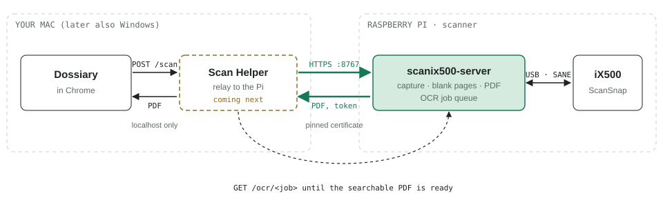
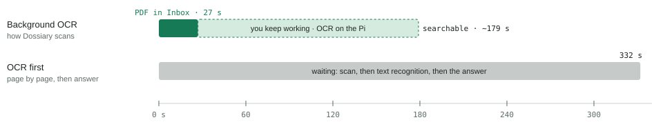

# scanix500 on a Raspberry Pi

Share the ScanSnap iX500 over the network: it hangs off a Raspberry Pi,
and every computer with Dossiary Scan Helper scans with it.

## What you need

- A Raspberry Pi 4 (2 GB or more) or Pi 5. A Pi 3 works, but turning
  scans into searchable PDFs is slow; a Zero 2 W is too small.
- Raspberry Pi OS **Lite**, based on Debian 12 ("bookworm") or Debian 13
  ("trixie"), 64-bit recommended.
- The iX500 and its USB cable.

## Install

1. Flash Raspberry Pi OS Lite with **Raspberry Pi Imager**. In its settings
   set a host name (e.g. `scanner`), your Wi-Fi (or use a cable), and
   enable SSH.
2. Start the Pi, plug in the iX500 and switch it on.
3. Log in (`ssh scanner.local`) and install the package from the
   [latest release](https://github.com/AarneAarebye/iX500/releases/latest):

       wget https://github.com/AarneAarebye/iX500/releases/download/v<version>/scanix500-server_<version>_all.deb
       sudo apt install ./scanix500-server_<version>_all.deb

   apt installs everything it needs (SANE, ocrmypdf, Tesseract with German
   and English) and starts the service. It prints the certificate
   fingerprint.
4. Check it: `sudo scanix500-server status` shows the scanner, the port
   (8767), the fingerprint and how many computers are paired (without
   sudo it can't read the fingerprint and pairings, and says so).
   The commands answer in your locale's language (German, Spanish, French, Chinese or Armenian when `LANG` is set to one of them); `sudo SCANIX500_LANG=en scanix500-server …` forces English.

## Pair a computer

In Dossiary Scan Helper choose **Add network scanner…**, pick the Pi, and
press the **Scan** button on the iX500 within 2 minutes. Without access to
the scanner, run `sudo scanix500-server pair` on the Pi and type the code
into the helper; compare the fingerprint the helper shows with the one the
Pi printed.

## How a scan travels

Dossiary never talks to the Pi itself. It asks Dossiary Scan Helper on the
same computer (`localhost`, as for a scanner plugged into that computer),
and the helper forwards the request to the Pi. Only that one hop crosses
the network, over HTTPS with the certificate the helper remembered when
it paired. This needs [Dossiary Scan Helper for macOS 0.3.0 or later](https://github.com/AarneAarebye/dossiary-scan-helper/releases)
(its **Add network scanner…** menu item).

**Once per computer: pairing**

1. The helper finds the Pi on the network (`_dossiary-scan._tcp`, by its
   host name).
2. It sends `POST /pair/button` with the computer's name.
3. You press **Scan** on the iX500 within 2 minutes.
4. The Pi gives that computer a token; the helper keeps it together with
   the Pi's certificate fingerprint.

**Every scan**

1. You click 📷 Scan in Dossiary and pick "ScanSnap iX500 (scanner)".
2. The helper forwards the request to the Pi, asking for text
   recognition in the background (`ocr: true`).
3. The Pi scans both sides, drops blank pages, builds the PDF and answers.
4. The PDF lands in Dossiary's Inbox; the Pi deletes its copy.
5. The helper asks for the text recognition job (`GET /ocr/<job>`) until
   it's done; the searchable PDF then replaces the scan in Dossiary, and
   the original is kept.

**How long it takes**

Measured on a Raspberry Pi with 6 two-sided A4 pages in colour at 300 dpi:
the scan comes back after **27 seconds**, and text recognition takes
about **2½ minutes** more in the background while you keep working.
Recognising the text before answering, page by page, made the same scan
take **332 seconds** before anything arrived, which is why Dossiary asks
for background text recognition. Text recognition is the slow part, so a
newer, faster Pi shortens the background step.

## Day to day

- `scanix500-server clients` lists paired computers;
  `sudo scanix500-server clients revoke "<name>"` removes one.
- Logs: `journalctl -u scanix500-server`.
- Other OCR languages: `sudo apt install tesseract-ocr-fra` (and so on).
- Settings (port, the name computers see): `/etc/scanix500/server.conf`,
  then `sudo dpkg-reconfigure scanix500-server`.

## Update and remove

- Update: download the newer `.deb` and `sudo apt install ./…` it. Pairings,
  certificate and settings are kept.
- Remove: `sudo apt remove scanix500-server`; `sudo apt purge
  scanix500-server` also deletes its settings, pairings and certificate.
