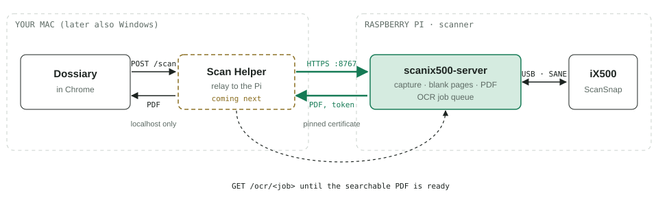

# scanix500 on a Raspberry Pi

Share the ScanSnap iX500 over the network: it hangs off a Raspberry Pi,
and every computer with Dossiary Scan Helper scans with it.

## What you need

- A Raspberry Pi 4 (2 GB or more) or Pi 5. A Pi 3 works, but turning
  scans into searchable PDFs is slow; a Zero 2 W is too small.
- Raspberry Pi OS **Lite**, based on Debian 12 ("bookworm") or Debian 13
  ("trixie"), 64-bit recommended.
- The iX500 and its USB cable.

## Install

1. Flash Raspberry Pi OS Lite with **Raspberry Pi Imager**. In its settings
   set a host name (e.g. `scanner`), your Wi-Fi (or use a cable), and
   enable SSH.
2. Start the Pi, plug in the iX500 and switch it on.
3. Log in (`ssh scanner.local`) and install the package from the
   [latest release](https://github.com/AarneAarebye/iX500/releases/latest):

       wget https://github.com/AarneAarebye/iX500/releases/download/v<version>/scanix500-server_<version>_all.deb
       sudo apt install ./scanix500-server_<version>_all.deb

   apt installs everything it needs (SANE, ocrmypdf, Tesseract with German
   and English) and starts the service. It prints the certificate
   fingerprint.
4. Check it: `sudo scanix500-server status` shows the scanner, the port
   (8767), the fingerprint and how many computers are paired (without
   sudo it can't read the fingerprint and pairings, and says so).
   The commands answer in your locale's language (German, Spanish, French, Chinese or Armenian when `LANG` is set to one of them); `sudo SCANIX500_LANG=en scanix500-server …` forces English.

## Pair a computer

In Dossiary Scan Helper choose **Add network scanner…**, pick the Pi, and
press the **Scan** button on the iX500 within 2 minutes. Without access to
the scanner, run `sudo scanix500-server pair` on the Pi and type the code
into the helper; compare the fingerprint the helper shows with the one the
Pi printed.

## How a scan travels



Dossiary never talks to the Pi itself. It asks Dossiary Scan Helper on the
same computer (`localhost`, as for a scanner plugged into that computer),
and the helper forwards the request to the Pi. Only that one hop crosses
the network, over HTTPS with the certificate the helper remembered when
it paired. This needs [Dossiary Scan Helper for macOS 0.3.0 or later](https://github.com/AarneAarebye/dossiary-scan-helper/releases)
(its **Add network scanner…** menu item).

**Once per computer: pairing**

1. The helper finds the Pi on the network (`_dossiary-scan._tcp`, by its
   host name).
2. It sends `POST /pair/button` with the computer's name.
3. You press **Scan** on the iX500 within 2 minutes.
4. The Pi gives that computer a token; the helper keeps it together with
   the Pi's certificate fingerprint.

**Every scan**

1. You click 📷 Scan in Dossiary and pick "ScanSnap iX500 (scanner)".
2. The helper forwards the request to the Pi, asking for text
   recognition in the background (`ocr: true`).
3. The Pi scans both sides, drops blank pages, builds the PDF and answers.
4. The PDF lands in Dossiary's Inbox; the Pi deletes its copy.
5. The helper asks for the text recognition job (`GET /ocr/<job>`) until
   it's done; the searchable PDF then replaces the scan in Dossiary, and
   the original is kept.

**How long it takes**


Measured on a Raspberry Pi with 6 two-sided A4 pages in colour at 300 dpi:
the scan comes back after **27 seconds**, and text recognition takes
about **2½ minutes** more in the background while you keep working.
Recognising the text before answering, page by page, made the same scan
take **332 seconds** before anything arrived, which is why Dossiary asks
for background text recognition. Text recognition is the slow part, so a
newer, faster Pi shortens the background step.

## Day to day

- `scanix500-server clients` lists paired computers;
  `sudo scanix500-server clients revoke "<name>"` removes one.
- Logs: `journalctl -u scanix500-server`.
- Other OCR languages: `sudo apt install tesseract-ocr-fra` (and so on).
- Settings (port, the name computers see): `/etc/scanix500/server.conf`,
  then `sudo dpkg-reconfigure scanix500-server`.

## Which scanners the server looks for

Only the ScanSnap iX500 and the CanoScan 8800F. The service and the commands
`scanix500` and `scanix500-server` set `SANE_CONFIG_DIR=/etc/scanix500/sane.d:`,
and `/etc/scanix500/sane.d/dll.conf` lists just the SANE backends `fujitsu`,
`epjitsu` and `pixma`. Network scanners are deliberately not searched: SANE's
network discovery (`net`, `airscan`, `bjnp`) added about 8 s to every scan. To
use another type of scanner, add its SANE backend name to that file (it is
kept across upgrades).

## CanoScan 8800F buttons (0.10.0)

With the CanoScan 8800F plugged in, its COLOR, BLACK & WHITE and CUSTOM buttons
each scan one page into an open collection; FINISH, or 10 minutes without a
press, closes it into one PDF. The text is recognised once over the whole PDF.
The PDF then waits on the Pi in `/var/lib/scanix500/button-scans/` until a
helper fetches and deletes it (Dossiary Scan Helper 0.6.0 or later, planned;
not available yet) or 30 days have passed. Pages being collected are in
`/var/lib/scanix500/collection/`. A page is refused when less than 200 MB is
free on that disk. Nothing is discarded by the server itself.

Keys in `/etc/scanix500/server.conf` (section `[server]`; restart the service
after a change):

| Key | Default | Valid values |
| --- | --- | --- |
| `collect_timeout_minutes` | `10` | a whole number, 1 or more |
| `button_custom_mode` | `gray` | `gray`, `color`, `bw` |
| `button_custom_resolution` | `300` | `150`, `300`, `600` (1200 dpi is over the 100-megapixel limit for an A4 page) |

COLOR and BLACK & WHITE always scan at 300 dpi. `scanix500-server status` shows
the open collection and how many PDFs wait; `scanix500-server button-scans list`
lists them; to drop an open collection, stop the service first
(`sudo systemctl stop scanix500-server`), then
`sudo scanix500-server button-scans discard-open`.

Plug scanners in while the Pi is switched off: hot-plugging one has frozen the
Pi until its power was cut.

## Button press feedback

A press of an 8800F button is announced at once, so a helper can beep or
flash. `GET /health` shows `"buttonEvent": {"seq": 3, "button": "color"}` to a
paired caller only (valid pairing token; `seq` counts presses since the service
started, `button` is `color`, `bw`, `custom` or `finish`, and `seq` alone is
`0` before the first press). Without a valid token the field is left out.

To make the Pi itself react, set a command in `/etc/scanix500/server.conf`
(section `[server]`; restart the service after a change):

```
button_feedback_command = /usr/bin/scanix500-beep
```

The server runs it with the button name as its last argument (`color`, `bw`,
`custom` or `finish`), as user `scanix500`, and stops it after 5 seconds. A
failing or slow command never delays a scan. `scanix500-server status` shows
the configured command.

## Sound from the Pi

The package ships `scanix500-beep`, which plays a short sound when a button is
pressed (one beep for `color`, `bw` and `custom`, a double beep for `finish`).

What you need: the Pi 4's 3.5 mm jack with a powered (active) speaker or
headphones, or a USB speaker or USB sound card. HDMI audio works too, with
`-D plughw:CARD=vc4hdmi0`.

Wiring:

```
Pi 3.5 mm jack ── audio cable ── powered speaker AUX in
```

The jack gives line level, right for powered speakers; headphones are fine,
passive speakers need an amplifier. The jack carries stereo audio (its fourth pole is composite video, not a
microphone), so use a plain stereo cable.

In an Argon ONE M.2 case the case's interface board moves the jack to the
back panel next to the two full-size HDMI ports; a slim or right-angle plug
fits best. The case's top hatch gives access to the GPIO pins if you would
rather drive an LED from `button_feedback_command`. The service user `scanix500` is not in group `gpio`, and the case itself
uses GPIO4 (power button) and GPIO2/3 (I2C for the fan).

Steps:

1. Make sure `dtparam=audio=on` is in `/boot/firmware/config.txt` (reboot after
   adding it).
2. `aplay -l` lists the sound cards (`Headphones` is the jack, `vc4hdmi0` and
   `vc4hdmi1` are HDMI). The beep uses `Headphones` when it exists, otherwise
   ALSA's default; for another card use `-D`, for example
   `button_feedback_command = /usr/bin/scanix500-beep -D plughw:CARD=<name from aplay -l>`.
3. Test: `sudo -u scanix500 scanix500-beep color`
4. Enable it in `/etc/scanix500/server.conf`, section `[server]`:
   `button_feedback_command = /usr/bin/scanix500-beep`
5. `sudo systemctl restart scanix500-server`

Volume: `alsamixer`, or `amixer -c Headphones sset PCM 80%`. `alsa-utils` saves
the ALSA state at shutdown.

## Update and remove

- Update: download the newer `.deb` and `sudo apt install ./…` it. Pairings,
  certificate and settings are kept.
- Remove: `sudo apt remove scanix500-server`; `sudo apt purge
  scanix500-server` also deletes its settings, pairings and certificate.
